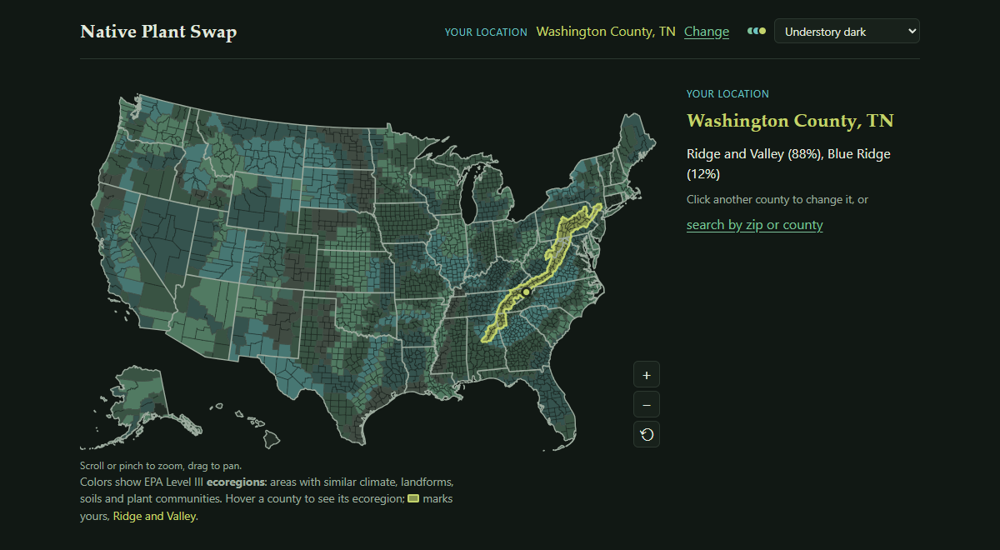

### Hi there, I'm Jayson 👋
- ⌨️ I'm a full-stack developer at WellSky, where I've worked remotely since 2021 building C#/.NET and React features for a healthcare call center platform.
- 📞 Most of my work is on patient phone systems, from Twilio IVRs to AI voice calls and call analysis.
- 🌱 My latest project is [Native Plant Swap](https://native-plant-swap-production.up.railway.app/), which shows you which plants are native where you live.
- 🥾 Outside of work I like hiking, cross-stitching, and Smash Bros tournaments.
- 💻 Older projects:
     - [Frame Advance](https://github.com/JaysonRice/FrameAdvance), a C# and React app for reviewing competitive game footage
     - [Bounce the Ball](https://github.com/JaysonRice/BounceTheBall), a browser game built with p5.js ([play it](https://bouncetheballgame.com/))
- 📫 Reach me at jayson.rice.95@gmail.com or check out my [portfolio](https://jaysonrice.github.io/).

### What I work with

  
  

### Native Plant Swap
Pick your county and see your ecoregion, the native plants recorded near you, and the wildlife they support.

